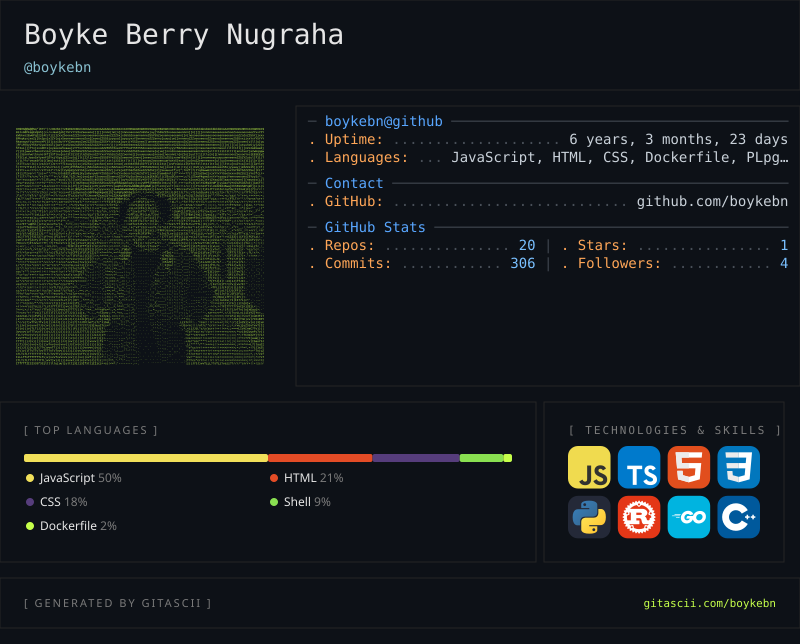

<div align="center">

  

  <a href="https://github.com/boykebn">
    
  </a>

  <p>
    <a href="https://github.com/boykebn?tab=followers"></a>
    <a href="https://github.com/boykebn?tab=repositories"></a>
    
    
  </p>

</div>

<br />

## `> profile --ascii`

<div align="center">
  <picture>
    <source
      media="(prefers-color-scheme: dark)"
      srcset="https://raw.githubusercontent.com/boykebn/boykebn/gitascii/profiles/default/dark.svg"
    />
    <source
      media="(prefers-color-scheme: light)"
      srcset="https://raw.githubusercontent.com/boykebn/boykebn/gitascii/profiles/default/light.svg"
    />
    
  </picture>
</div>

<br />

## `> whoami`

```ts
const boyke = {
  name: "Boyke Berry Nugraha",
  role: "Backend-focused Fullstack Developer",
  location: "Indonesia",
  backend: ["Node.js", "Express.js", "PostgreSQL", "REST API"],
  frontend: ["React", "Next.js", "React Native"],
  focus: ["Business systems", "System integration", "Reliable workflows"],
};
```

I build web and mobile applications for business operations—from backend APIs and relational databases to mobile workflows, system integrations, and production deployment.

<br />

## `> tech --stack`

<div align="center">
  
</div>

<br />

## `> projects --featured`

<table>
  <tr>
    <td width="50%" valign="top">
      <h3 align="center">PPIC &amp; Warehouse System</h3>
      <p align="center">
        Backend services and operational workflows for production planning, inventory, warehouse processes, stock management, and scheduled data synchronization.
        <br /><br />
        <code>Node.js</code> <code>Express.js</code> <code>PostgreSQL</code>
      </p>
    </td>
    <td width="50%" valign="top">
      <h3 align="center">Mobile Distribution Workflow</h3>
      <p align="center">
        Mobile operational workflows with barcode scanning, API integration, and Bluetooth thermal-label printing.
        <br /><br />
        <code>React Native</code> <code>REST API</code> <code>PostgreSQL</code>
      </p>
    </td>
  </tr>
</table>

<div align="center">
  <a href="https://github.com/boykebn?tab=repositories"></a>
</div>

<br />

## `> contributions --play`

<div align="center">
  <picture>
    <source media="(prefers-color-scheme: dark)" srcset="https://raw.githubusercontent.com/boykebn/boykebn/output/github-contribution-grid-snake-dark.svg" />
    <source media="(prefers-color-scheme: light)" srcset="https://raw.githubusercontent.com/boykebn/boykebn/output/github-contribution-grid-snake.svg" />
    
  </picture>
</div>

<br />

<div align="center">

  ### Let’s build reliable systems that solve real problems.

  <a href="https://github.com/boykebn"></a>

  <br /><br />
  <sub>Backend systems • Business workflows • Practical integrations</sub>

</div>


